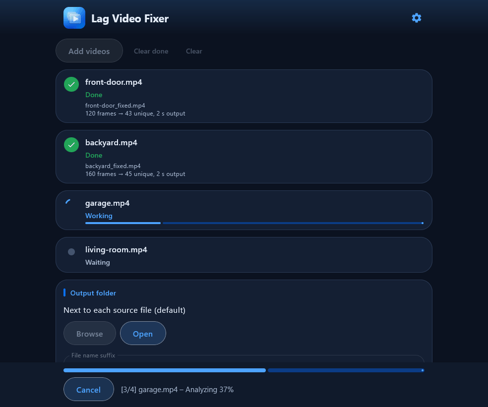
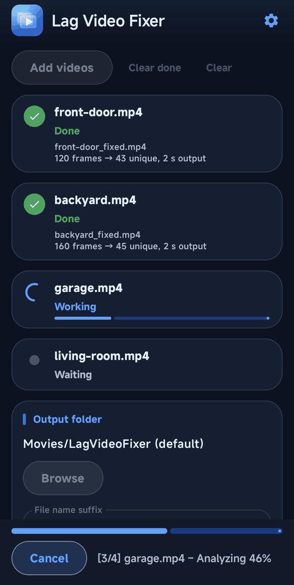
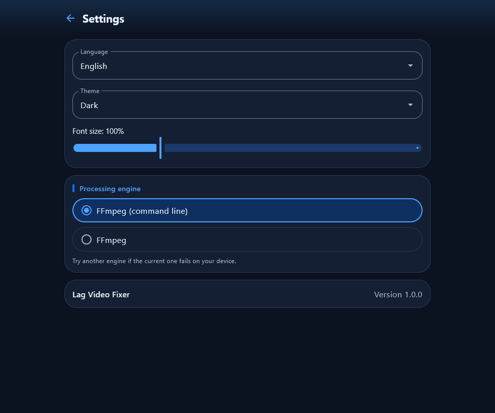
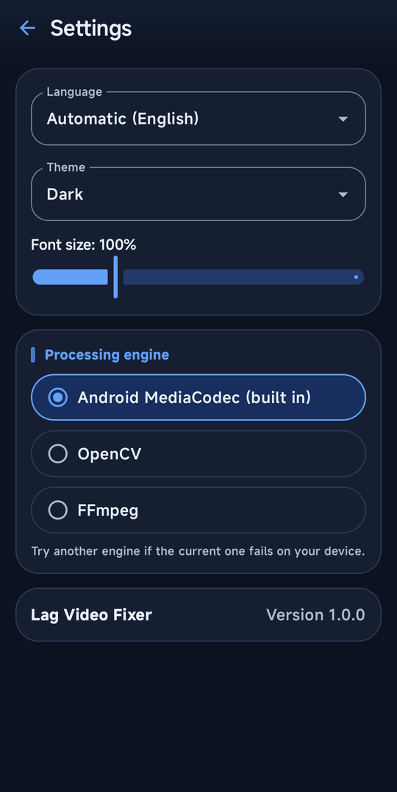

# Lag Video Fixer

Removes the repeated frames from stuttering camera recordings so they play smoothly again. Runs on Windows, macOS, Linux and Android.

> **This is not AI frame interpolation.** It never generates a picture. Every frame of the output is a real frame of the original recording; the tool only removes the repeated ones.

<table>
  <tr>
    <td></td>
    <td></td>
  </tr>
  <tr>
    <td align="center">Windows</td>
    <td align="center">Android</td>
  </tr>
</table>

## When it helps

A video stutters like this when it was recorded at a fixed frame rate from a source that could not deliver that many pictures, for example a network camera or a live stream on a poor connection. Each missing picture is filled by repeating the previous one, so playback is smooth for a moment, freezes, then jumps to the next picture. This tool finds the repeated frames and removes them, keeping only frames where the picture actually changed.

One example: saving footage from a **Xiaomi camera** at home to your phone with the **Xiaomi Home** app while you are away. When the home upload is slow or the phone's signal is weak, the saved video stutters badly, and a large share of its frames are copies of the frame before.

## Modes

| Mode | How | Result |
|---|---|---|
| **Remove duplicate frames only** (default) | Compares each frame with the last kept one and drops it when they are almost identical | Motion is continuous; frozen stretches are removed, so the video gets shorter |
| **Sync to the on-screen clock** | Finds the time burned into the picture (such as the date and time in the corner of Xiaomi camera footage) and uses it as the real timeline, spreading each second's real frames evenly across that second | The original length is kept and every picture appears at its real time; a stretch with no new pictures holds the last one |

- The clock is found without OCR or any knowledge of the font: the order of the digits is learned from how the seconds digit changes.
- The rows of the clock are ignored when frames are compared, so a frame whose clock ticked but whose picture did not change still counts as a repeat.
- The output keeps the original resolution and orientation (portrait videos and videos with rotation metadata are not distorted) and is written as H.264 MP4.

## Download

Get the files from the **Releases** page:

| System | Installer | Portable (no installation) |
|---|---|---|
| Windows | `.msi` | `-portable.exe`: a single file, just run it |
| macOS (Apple silicon) | `.dmg` | `-portable.zip`: unzip and open `LagVideoFixer.app` |
| Linux | `.deb` | `-portable.tar.gz`: unpack and run `bin/LagVideoFixer` |
| Android 10 or later | `-android-arm64.apk` for phones and tablets; `-android-x86_64.apk` for emulators and x86 devices | |

- The desktop versions include their own Java runtime and FFmpeg; nothing else needs to be installed.
- The Windows portable exe unpacks itself into `%LOCALAPPDATA%\LagVideoFixer\app` the first time each version starts (a few seconds) and starts directly after that. Older versions there are removed automatically.
- The macOS version is not notarized by Apple, so macOS blocks it the first time: open System Settings > Privacy & Security and choose "Open Anyway".
- Intel Macs are not supported.

## Usage

1. Click "Add videos", or drag videos or whole folders onto the window (every video inside a folder is added). On Android you can also share videos to the app from the gallery or a file manager.
2. Pick a mode under "Mode" and press "Start". The listed videos are processed one after another; "Cancel" stops at any time.
3. Each output is named after its source plus the "File name suffix" (`_fixed` by default). Existing files are never overwritten; a number such as ` (2)` is added instead.
   - Desktop: saved next to the source video by default. "Browse" under "Output folder" picks another folder.
   - Android: saved to `Movies/LagVideoFixer` by default. "Browse" under "Output folder" picks another folder. Processing continues in the background and a notification tells you when it is done.

"Options" on the main screen:

| Option | Default | Meaning |
|---|---|---|
| Output FPS | 20 | Frame rate of the output |
| Duplicate threshold | 0.08 | Two frames whose mean brightness difference (0 to 255) is below this count as the same picture. Higher drops more frames, lower keeps more |
| Quality (CRF, lower = better) | 20 | 0 to 51; lower means better quality and larger files |

"Settings" (the gear icon): "Language" (26 languages), "Theme" (System, Light, Dark, Black), "Font size" and "Processing engine".

<table>
  <tr>
    <td></td>
    <td></td>
  </tr>
</table>

### Processing engine

The engine reads and writes the video. The default works on most devices; if a video fails, try another one under "Processing engine" in Settings. Only engines that work on your device are listed.

| Engine | Android | Desktop |
|---|---|---|
| Android MediaCodec (built in) | yes (default) | |
| OpenCV | yes | |
| FFmpeg | yes (ARM devices only) | yes |
| FFmpeg (command line) | | yes (default): uses the `ffmpeg` installed on the computer, otherwise the bundled one |

### Command line (desktop)

```
LagVideoFixer --cli [--engine=FFMPEG_CLI|FFMPEG] [--mode=plain|clock] [--report=result.txt] videos-or-folders...
```

- Each result is saved next to its source as `<name>_<engine>.mp4`.
- Without `--engine`, every available engine runs once.
- `--report` also writes the results to a file. Use it on Windows, where the app prints nothing to the console.

## Building from source

Requires JDK 17, plus the Android SDK 36 for the Android app.

```
./gradlew :desktop:run              # run the desktop app
./gradlew :android:assembleDebug    # build the Android APKs
```

Translations are in `shared/ui/src/commonMain/composeResources/files/locales/`, one JSON file per language. Missing strings fall back to English.

## License

[GPL-3.0](LICENSE)

**Third-party components:**

| Component | Included in | License |
|---|---|---|
| FFmpeg 8.1 with x264 (built by JavaCV) | Desktop | GPL-3.0-or-later |
| JavaCV, JavaCPP | Desktop | Apache-2.0 (or GPL-2.0 with Classpath Exception) |
| Java runtime (OpenJDK 17, Eclipse Temurin) | Desktop | GPL-2.0 with Classpath Exception |
| FileKit | Desktop | MIT |
| FFmpegKit (full) 9.0 | Android | LGPL-3.0 |
| OpenCV 5.1 | Android | Apache-2.0 |
| Kotlin, Compose Multiplatform, AndroidX, Koin, Okio | Desktop and Android | Apache-2.0 |

**What this means:**

- Using the apps, for any purpose, has no conditions.
- The videos you produce are yours; none of these licenses applies to them.
- Redistributing the **desktop** downloads: they contain FFmpeg under GPL-3.0, so they may only be redistributed under GPL-3.0. That means including the license text and making the corresponding source code available.
- Redistributing the **Android** APKs: FFmpegKit is LGPL-3.0, so its license text and source code must be made available; OpenCV and the other Apache-2.0 components need their license and notices included.
